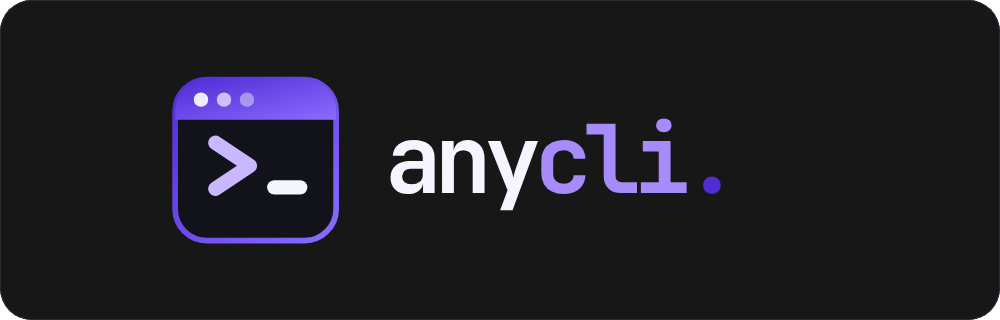

<!--
SPDX-FileCopyrightText: 2026 Adam Shirt <adamshirt@outlook.com>

SPDX-License-Identifier: MIT
-->



AnyCli is a source-generated, AOT-friendly command-line framework for .NET with typed command parameters.

Read the [documentation](https://drmathias.github.io/anycli/) for getting started, guides, and the API reference.

[](https://github.com/drmathias/anycli/actions/workflows/test.yml)
[](https://github.com/drmathias/anycli/blob/main/LICENSES/MIT.txt)
[](https://dotnet.microsoft.com/)
[](https://dotnet.microsoft.com/)
[](https://learn.microsoft.com/dotnet/core/deploying/native-aot/)

## Philosophy

AnyCli is optimised for both utility and extensibility. It is mildly opinionated and suitable for building almost all types of CLI apps. If your use case isn't supported, please open an issue.

## Packages

| Package | Version | Description |
| --- | --- | --- |
| `AnyCli` | [](https://www.nuget.org/packages/AnyCli) | Core command-line framework and source generator. |
| `AnyCli.SpectreConsole` | [](https://www.nuget.org/packages/AnyCli.SpectreConsole) | Spectre.Console integration for ANSI command output. |

## Features

- AOT-compatible command registration and execution
- Source-generated parameter binding with no runtime reflection
- Typed positional arguments and named options
- Required, optional, variadic, collection, and defaulted parameters
- Nested command groups
- Custom value parsers
- Dependency injection support
- Typed enum exit codes
- Typed global options
- Interceptor middleware
- Cancellation support for async commands and interceptors
- Fully customisable help and error handling
- Built in internationalisation - localized error messages and help for English, French, German, Spanish, Brazilian Portuguese, Italian, and Dutch
- Configurable localization
- Optional Spectre.Console adapter for rich, styled terminal output and error messages (tables, markup, progress bars etc.)

## Installation

```bash
dotnet add package AnyCli
```

For Spectre.Console integration:

```bash
dotnet add package AnyCli.SpectreConsole
```

## Benchmarks

<!-- benchmarks:start -->
_Environment: macOS Tahoe 26.2, Intel Core i7-9750H, 12 logical cores, .NET SDK 11.0.100, .NET 11.0.0, X64._

### Invocation

| Rank | Framework | Mean | Median | Ratio | Allocated |
| ---: | --- | ---: | ---: | ---: | ---: |
| 1 | ConsoleAppFramework | 8.818 ns | 8.813 ns | 0.009 | 0 B |
| **2** | **AnyCli** | **977.333 ns** | **970.310 ns** | **1.000** | **1336 B** |
| 3 | XenoAtom.CommandLine | 2,036.816 ns | 2,027.130 ns | 2.084 | 2992 B |
| 4 | CliFx | 3,890.292 ns | 3,816.805 ns | 3.981 | 4392 B |
| 4 | System.CommandLine | 4,088.372 ns | 4,154.365 ns | 4.184 | 4848 B |
| 5 | Spectre.Console.Cli | 105,364.596 ns | 105,171.187 ns | 107.831 | 45646 B |

### Cold start (JIT)

| Rank | Framework | Mean | Median | Ratio |
| ---: | --- | ---: | ---: | ---: |
| 1 | ConsoleAppFramework | 68.95 ms | 68.98 ms | 0.55 |
| 2 | CliFx | 120.92 ms | 121.34 ms | 0.97 |
| 2 | XenoAtom.CommandLine | 123.50 ms | 124.34 ms | 0.99 |
| **2** | **AnyCli** | **125.50 ms** | **126.49 ms** | **1.00** |
| 2 | System.CommandLine | 131.73 ms | 130.31 ms | 1.05 |
| 3 | Spectre.Console.Cli | 231.63 ms | 230.72 ms | 1.85 |

### Cold start (NativeAOT)

| Rank | Framework | Mean | Median | Ratio |
| ---: | --- | ---: | ---: | ---: |
| 1 | ConsoleAppFramework | 11.32 ms | 10.79 ms | 0.98 |
| **1** | **AnyCli** | **11.57 ms** | **11.33 ms** | **1.00** |
| 1 | XenoAtom.CommandLine | 12.04 ms | 11.93 ms | 1.04 |
| 1 | System.CommandLine | 13.04 ms | 12.88 ms | 1.13 |
| 1 | CliFx | 13.12 ms | 13.07 ms | 1.14 |

_Ranks are BenchmarkDotNet statistical ranks; ties indicate statistically similar results._
<!-- benchmarks:end -->

## Kudos

Inspiration for the framework primarily comes from both [ConsoleAppFramework](https://github.com/Cysharp/ConsoleAppFramework) and [Spectre.Console.Cli](https://github.com/spectreconsole/spectre.console.cli).

## License

MIT
