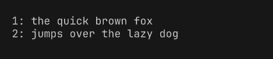

<!--
SPDX-FileCopyrightText: 2026 Adam Shirt <adamshirt@outlook.com>

SPDX-License-Identifier: MIT
-->

# Arguments and Options

`fsinspect` currently has one command. In this step, you'll add `preview`, which prints the first lines of a file with line numbers. Along the way, you'll see how AnyCLI binds a required positional argument and an option with a default value.

## Add the parameters

Add this parameter type to the project:

```csharp
using AnyCli.Parameters.Arguments;
using AnyCli.Parameters.Options;

public sealed partial record PreviewParameters
{
    [Argument(0)]
    public required string Path { get; init; }

    [Option("--lines", "-n")]
    public int Lines { get; init; } = 10;
}
```

`[Argument(0)]` declares a required positional argument at position zero. `[Option]` declares a named option with a short alias, and its property initializer provides the default value when the option is omitted.

## Add the command

Add the command below the parameter type:

```csharp
using AnyCli.Commands.Execution;

public sealed class PreviewCommand : IAsyncCommand<PreviewParameters>
{
    public async Task<int> ExecuteAsync(
        CommandContext context,
        PreviewParameters parameters,
        CancellationToken cancellationToken)
    {
        if (!File.Exists(parameters.Path))
        {
            context.Console.Error.WriteLine($"File not found: {parameters.Path}");
            return 1;
        }

        var number = 0;
        await foreach (var line in File.ReadLinesAsync(parameters.Path, cancellationToken))
        {
            if (number == parameters.Lines) break;
            number++;
            context.Console.Output.WriteLine($"{number}: {line}");
        }

        return 0;
    }
}
```

`IAsyncCommand<T>` receives the parsed parameters and a cancellation token. AnyCLI binds the argument and option before `ExecuteAsync` runs, so the command does not parse the command line itself.

## Register the command

Update the command registration in `Program.cs`:

```csharp
var app = ConsoleAppBuilder.Create()
    .WithName("fsinspect")
    .ConfigureCommands(commands => commands
        .AddCommand<InspectCommand>("info", "Show information about the current directory")
        .AddAsyncCommand<PreviewCommand, PreviewParameters>("preview", "Preview the first lines of a file"))
    .Build();
```

`AddAsyncCommand` registers an asynchronous command with typed parameters.

## Run the app

Create `sample.txt`:

```text
the quick brown fox
jumps over the lazy dog
the dog barks
```

Preview the first two lines:

```bash
dotnet run -- preview sample.txt --lines 2
```



The short alias and `=` form work as well:

```bash
dotnet run -- preview sample.txt -n 2
dotnet run -- preview sample.txt --lines=2
```

When `--lines` is omitted, the command uses the default value of `10`:

```bash
dotnet run -- preview sample.txt
```

If the file does not exist, the command writes an error and returns exit code `1`. If the path argument is omitted, AnyCLI reports a structured command-line error and returns exit code `2`.

## Next

- [Styled Output With Spectre.Console](styled-output-with-spectreconsole.md)
