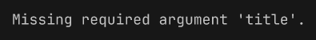

<!--
SPDX-FileCopyrightText: 2026 Adam Shirt <adamshirt@outlook.com>

SPDX-License-Identifier: MIT
-->

# Arguments and Options

Users expect to add tasks without editing a data file. Right now, every `todo` task has to be added by editing `todo.json`. In this step, you'll add an async `add` command with a required title argument and a priority option.

## Add task priority

Update `TodoItem` and add a priority enum:

```csharp
public enum TodoPriority
{
    Low,
    Normal,
    High,
}

/// <summary>A persisted task.</summary>
public sealed record TodoItem(
    int Id,
    string Title,
    TodoPriority Priority,
    bool IsDone = false);
```

## Add the save method

Update `TodoStore` with a method that writes tasks asynchronously:

```csharp
public async Task SaveAsync(
    IReadOnlyList<TodoItem> tasks,
    CancellationToken cancellationToken)
{
    var json = JsonSerializer.Serialize(tasks);
    await File.WriteAllTextAsync(path, json, cancellationToken);
}
```

## Add the parameters

Add this parameter type to the project:

```csharp
using AnyCli.Parameters.Arguments;
using AnyCli.Parameters.Options;

public sealed partial record AddParameters
{
    [Argument(0)]
    public required string Title { get; init; }

    [Option("--priority", "-p")]
    public TodoPriority Priority { get; init; } = TodoPriority.Normal;
}
```

`[Argument(0)]` declares a required positional argument at position zero. `[Option]` declares a named option with a short alias, and its property initializer provides the default value when the option is omitted.

## Add the command

Add the async command below the parameter type:

```csharp
public sealed class AddCommand : IAsyncCommand<AddParameters>
{
    public async Task<int> ExecuteAsync(
        CommandContext context,
        AddParameters parameters,
        CancellationToken cancellationToken)
    {
        var store = new TodoStore("todo.json");
        var tasks = (await store.LoadAsync(cancellationToken)).ToList();
        var id = tasks.Count == 0 ? 1 : tasks.Max(task => task.Id) + 1;

        tasks.Add(new TodoItem(id, parameters.Title, parameters.Priority));
        await store.SaveAsync(tasks, cancellationToken);

        context.Console.Output.WriteLine($"Added task {id}: {parameters.Title}");
        return 0;
    }
}
```

`IAsyncCommand<T>` receives the parsed parameters and a cancellation token. AnyCLI binds the argument and option before `ExecuteAsync` runs, so the command does not parse the command line itself.

## Register the command

Update the command registration in `Program.cs`:

```csharp
var app = ConsoleAppBuilder.Create()
    .WithName("todo")
    .ConfigureCommands(commands => commands
        .AddAsyncCommand<ListCommand>("list", "List all tasks")
        .AddAsyncCommand<AddCommand, AddParameters>("add", "Add a task"))
    .Build();
```

`AddAsyncCommand` registers an asynchronous command with typed parameters.

## Run the app

Add a task:

```bash
dotnet run -- add "Write docs" --priority high
```

```text
Added task 1: Write docs
```


The short alias and `=` form work as well:

```bash
dotnet run -- add "Review PR" -p normal
dotnet run -- add "Ship release" --priority=high
```

When `--priority` is omitted, the command uses `TodoPriority.Normal`:

```bash
dotnet run -- add "Plan next sprint"
```

Omit the title:

```bash
dotnet run -- add
```



AnyCLI reports a structured command-line error and returns exit code `2`.

## Next

- [Styled Output With Spectre.Console](styled-output-with-spectreconsole.md)
