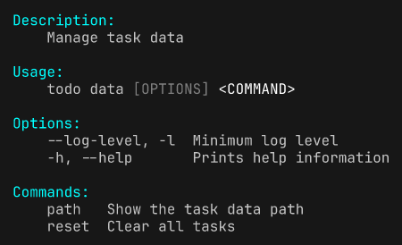
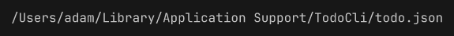
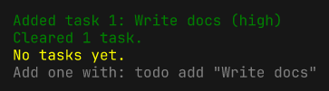

<!--
SPDX-FileCopyrightText: 2026 Adam Shirt <adamshirt@outlook.com>

SPDX-License-Identifier: MIT
-->

# Command Groups

A flat command list works while `todo` is small. As commands accumulate, related operations are easier to discover when they live under a shared group. In this step, you'll add a `data` group with two commands: one that shows where tasks are stored and one that clears the task list.

The existing `list`, `add`, and `done` commands stay at the root. A command group is a container for subcommands; it does not execute on its own.

## Add the parameter types

Every command in a group still receives the application's global options and returns its typed exit code. Add parameter types that inherit `TodoGlobalOptions`:

```csharp
public sealed partial record DataPathParameters : TodoGlobalOptions;

public sealed partial record DataResetParameters : TodoGlobalOptions;
```

## Add the commands

Add the two commands to the project:

```csharp
public sealed class DataPathCommand
    : IAsyncCommand<DataPathParameters, TodoExitCode>
{
    public Task<TodoExitCode> ExecuteAsync(
        CommandContext context,
        DataPathParameters parameters,
        CancellationToken cancellationToken)
    {
        context.Console.Output.WriteLine(JsonTodoStore.DataPath);
        return Task.FromResult(TodoExitCode.Success);
    }
}

public sealed class DataResetCommand(ITodoStore store)
    : IAsyncCommand<DataResetParameters, TodoExitCode>
{
    public async Task<TodoExitCode> ExecuteAsync(
        CommandContext context,
        DataResetParameters parameters,
        CancellationToken cancellationToken)
    {
        var tasks = await store.LoadAsync(cancellationToken);
        await store.SaveAsync([], cancellationToken);

        if (tasks.Count == 0)
        {
            context.AnsiConsole.Output.MarkupLine("[yellow]No tasks to clear.[/]");
            return TodoExitCode.Success;
        }

        var noun = tasks.Count == 1 ? "task" : "tasks";
        context.AnsiConsole.Output.MarkupLineInterpolated(
            $"[green]Cleared [bold]{tasks.Count}[/] {noun}.[/]");
        return TodoExitCode.Success;
    }
}
```

`DataResetCommand` injects `ITodoStore`, loads the current tasks, and replaces the store contents with an empty list. It uses that count to report how many tasks were cleared. `DataPathCommand` uses plain output because a filesystem path should be printed literally.

## Register the commands

Register the new commands with the container:

```csharp
services.AddTransient<DataPathCommand>();
services.AddTransient<DataResetCommand>();
```

## Add the group

Add the `data` group inside `ConfigureCommands`:

```csharp
var app = ConsoleAppBuilder.Create()
    .UseServiceProvider(provider)
    .WithName("todo")
    .AddGlobalOptions<TodoGlobalOptions>()
    .ConfigureHelp(help => help
        .UseSpectreHelp())
    .ConfigureErrorHandling(errors => errors
        .UseSpectreErrors()
        .UseExitCode(TodoExitCode.CommandLineError))
    .ConfigureCommands<TodoExitCode>(commands => commands
        .AddAsyncCommand<ListCommand, ListParameters>("list", "List all tasks")
        .AddAsyncCommand<AddCommand, AddParameters>("add", "Add a task")
        .AddAsyncCommand<DoneCommand, DoneParameters>("done", "Mark a task as done")
        .AddGroup("data", "Manage task data", data => data
            .AddAsyncCommand<DataPathCommand, DataPathParameters>(
                "path", "Show the task data path")
            .AddAsyncCommand<DataResetCommand, DataResetParameters>(
                "reset", "Clear all tasks")))
    .AddInterceptor<LogLevelInterceptor>()
    .AddInterceptor<LoggingInterceptor>()
    .Build();
```

`AddGroup` creates the `data` node, and the callback registers its child commands. Groups can contain other groups by calling `AddGroup` again inside the callback.

## Run the app

Inspect the group's help:

```text
dotnet run -- data --help
```



Running `todo data` without a subcommand reports that a subcommand is required and returns exit code `2`.

Show the data path:

```bash
dotnet run -- data path
```

The exact path depends on your operating system, but it always points at the per-user application data directory.



Clear the task list:

```bash
dotnet run -- add "Write docs" --priority high
dotnet run -- data reset
dotnet run -- list
```



## Next

- [Localize the App](localize-the-app.md)
