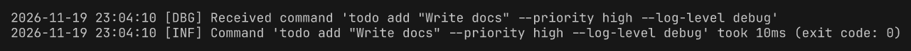

<!--
SPDX-FileCopyrightText: 2026 Adam Shirt <adamshirt@outlook.com>

SPDX-License-Identifier: MIT
-->

# Global Options

As it stands `todo` currently logs at a fixed `Information` level. In this step, you'll add a global `--log-level` option so users can control the amount of diagnostic output without changing the application code.

## Add the global options type

Add the global options type to the project:

```csharp
using System.ComponentModel;

using Microsoft.Extensions.Logging;

[GlobalOptions]
public partial record TodoGlobalOptions
{
    [Option("--log-level", "-l")]
    [Description("Minimum log level")]
    public LogLevel LogLevel { get; init; } = LogLevel.Information;
}
```

AnyCLI parses enum option values case-insensitively by default, so `--log-level debug` and `--log-level Debug` are equivalent.

## Update the command parameters

Global options are inherited by command parameter types. Update the existing parameter types and add an empty parameter type for `list`:

```csharp
public sealed partial record ListParameters : TodoGlobalOptions;

public sealed partial record AddParameters : TodoGlobalOptions
{
    [Argument(0)]
    public required string Title { get; init; }

    [Option("--priority", "-p")]
    public TodoPriority Priority { get; init; } = TodoPriority.Normal;
}

public sealed partial record DoneParameters : TodoGlobalOptions
{
    [Argument(0)]
    public int Id { get; init; }
}
```

Change `ListCommand` to implement `IAsyncCommand<ListParameters, TodoExitCode>` so it can receive global options. Its command body does not need to use `parameters` yet.

## Add the log-level interceptor

The global option is applied before logging runs by a typed interceptor:

```csharp
using AnyCli.Interceptors;
using Microsoft.Extensions.Logging;
using Serilog.Core;
using Serilog.Events;

public sealed class LogLevelInterceptor(
    LoggingLevelSwitch levelSwitch) : ICommandInterceptor<TodoGlobalOptions>
{
    public Task<int> InterceptAsync(
        CommandInterceptorContext<TodoGlobalOptions> context,
        Func<CancellationToken, Task<int>> next,
        CancellationToken cancellationToken)
    {
        levelSwitch.MinimumLevel = ToSerilogLevel(context.GlobalOptions.LogLevel);
        return next.Invoke(cancellationToken);
    }

    private static LogEventLevel ToSerilogLevel(LogLevel level) =>
        level switch
        {
            LogLevel.Trace => LogEventLevel.Verbose,
            LogLevel.Debug => LogEventLevel.Debug,
            LogLevel.Information => LogEventLevel.Information,
            LogLevel.Warning => LogEventLevel.Warning,
            LogLevel.Error => LogEventLevel.Error,
            LogLevel.Critical => LogEventLevel.Fatal,
            LogLevel.None => LogEventLevel.Fatal,
            _ => LogEventLevel.Information,
        };
}
```

The interceptor must be registered before `LoggingInterceptor`, because interceptors run in registration order.

## Configure the level switch

Create a Serilog `LoggingLevelSwitch` with the default `Information` level and register it with the container:

```csharp
using Serilog.Core;
using Serilog.Events;

var levelSwitch = new LoggingLevelSwitch(LogEventLevel.Information);

Log.Logger = new LoggerConfiguration()
    .MinimumLevel.ControlledBy(levelSwitch)
    .WriteTo.File(
        "todo.log",
        outputTemplate: "{Timestamp:yyyy-MM-dd HH:mm:ss} [{Level:u3}] {Message:lj}{NewLine}")
    .CreateLogger();

services.AddSingleton(levelSwitch);
services.AddTransient<LogLevelInterceptor>();
```

## Register the global options and interceptor

Add the global options and interceptor to the app registration:

```csharp
var app = ConsoleAppBuilder.Create()
    .UseServiceProvider(provider)
    .WithName("todo")
    .AddGlobalOptions<TodoGlobalOptions>()
    .ConfigureHelp(help => help
        .UseSpectreHelp())
    .ConfigureErrorHandling(errors => errors
        .UseSpectreErrors()
        .UseExitCode(TodoExitCode.CommandLineError))
    .ConfigureCommands<TodoExitCode>(commands => commands
        .AddAsyncCommand<ListCommand, ListParameters>("list", "List all tasks")
        .AddAsyncCommand<AddCommand, AddParameters>("add", "Add a task")
        .AddAsyncCommand<DoneCommand, DoneParameters>("done", "Mark a task as done"))
    .AddInterceptor<LogLevelInterceptor>()
    .AddInterceptor<LoggingInterceptor>()
    .Build();
```

## Run the app

Run the `add` command with debug logging enabled:

```bash
dotnet run -- add "Write docs" --priority high --log-level debug
cat todo.log
```

<p></p>

The debug message is now written to the log file.

Global options can also appear before the command:

```bash
dotnet run -- --log-level debug add "Write docs" --priority high
```

## Next

- [Command Groups](command-groups.md)
