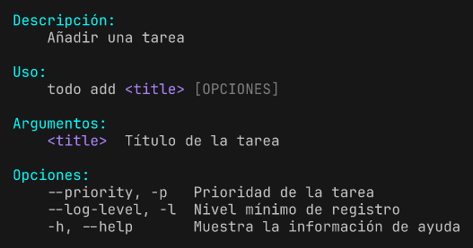

<!--
SPDX-FileCopyrightText: 2026 Adam Shirt <adamshirt@outlook.com>

SPDX-License-Identifier: MIT
-->

# Localize the App

AnyCLI localizes its built-in help headings, standard option descriptions, and command-line errors for English, French, German, Spanish, Brazilian Portuguese, Italian, and Dutch. In this step, you'll choose the UI culture at runtime and localize the text that belongs to `todo`.

## Configure the culture

Add the remaining usings to `Program.cs`:

```csharp
using System.Globalization;

using AnyCli.Help;
using AnyCli.Localization;
```

Read the requested language from an environment variable, falling back to the current UI culture, then configure localization on the application builder:

```csharp
var language = Environment.GetEnvironmentVariable("TODO_LANG");
var culture = string.IsNullOrWhiteSpace(language)
    ? CultureInfo.CurrentUICulture
    : CultureInfo.GetCultureInfo(language);

var app = ConsoleAppBuilder.Create()
    .UseServiceProvider(provider)
    .WithName("todo")
    .AddGlobalOptions<TodoGlobalOptions>()
    .ConfigureLocalization(LocalizationOptions.FromCulture(culture))
    .ConfigureHelp(help => help
        .UseLocalizedTextProvider(
            "TodoCli.HelpDescriptions",
            typeof(JsonTodoStore).Assembly)
        .UseSpectreHelp())
    .ConfigureErrorHandling(errors => errors
        .UseSpectreErrors()
        .UseExitCode(TodoExitCode.CommandLineError))
    .ConfigureCommands<TodoExitCode>(commands => commands
        .AddAsyncCommand<ListCommand, ListParameters>(
            "list", HelpText.FromResource("ListDescription"))
        .AddAsyncCommand<AddCommand, AddParameters>(
            "add", HelpText.FromResource("AddDescription"))
        .AddAsyncCommand<DoneCommand, DoneParameters>(
            "done", HelpText.FromResource("DoneDescription"))
        .AddGroup("data", HelpText.FromResource("DataDescription"), data => data
            .AddAsyncCommand<DataPathCommand, DataPathParameters>(
                "path", HelpText.FromResource("DataPathDescription"))
            .AddAsyncCommand<DataResetCommand, DataResetParameters>(
                "reset", HelpText.FromResource("DataResetDescription"))))
    .AddInterceptor<LogLevelInterceptor>()
    .AddInterceptor<LoggingInterceptor>()
    .Build();
```

`LocalizationOptions.FromCulture` uses the same culture for both UI text and formatting. If you need different cultures, configure `UICultureProvider` and `FormatCultureProvider` separately.

## Add the resources

Create `HelpDescriptions.resx` in the project root for the fallback text:

| Key | English |
| --- | --- |
| `ListDescription` | List all tasks |
| `AddDescription` | Add a task |
| `DoneDescription` | Mark a task as done |
| `DataDescription` | Manage task data |
| `DataPathDescription` | Show the task data path |
| `DataResetDescription` | Clear all tasks |
| `TitleDescription` | Task title |
| `PriorityDescription` | Task priority |
| `LogLevelDescription` | Minimum log level |

Add `HelpDescriptions.es.resx` for Spanish:

| Key | Spanish |
| --- | --- |
| `ListDescription` | Listar todas las tareas |
| `AddDescription` | Añadir una tarea |
| `DoneDescription` | Marcar una tarea como completada |
| `DataDescription` | Gestionar los datos de las tareas |
| `DataPathDescription` | Mostrar la ruta de los datos |
| `DataResetDescription` | Borrar todas las tareas |
| `TitleDescription` | Título de la tarea |
| `PriorityDescription` | Prioridad de la tarea |
| `LogLevelDescription` | Nivel mínimo de registro |

The neutral resource file is the fallback when a key is missing from a translated file. `TodoCli.HelpDescriptions` is the project root namespace plus the resource file name; if your project uses a different root namespace, use that instead.

## Localize parameter descriptions

Keep the literal `[Description]` text as a fallback and add a `[ResourceDescription]` key. Update `AddParameters` and `TodoGlobalOptions`:

```csharp
public sealed partial record AddParameters : TodoGlobalOptions
{
    [Argument(0)]
    [Description("Task title")]
    [ResourceDescription("TitleDescription")]
    public required string Title { get; init; }

    [Option("--priority", "-p")]
    [Description("Task priority")]
    [ResourceDescription("PriorityDescription")]
    public TodoPriority Priority { get; init; } = TodoPriority.Normal;
}

[GlobalOptions]
public partial record TodoGlobalOptions
{
    [Option("--log-level", "-l")]
    [Description("Minimum log level")]
    [ResourceDescription("LogLevelDescription")]
    public LogLevel LogLevel { get; init; } = LogLevel.Information;
}
```

Command descriptions use `HelpText.FromResource(...)` in the registration above. Parameter descriptions use `[ResourceDescription]` because they are declared on the parameter properties.

## Run the app

On macOS or Linux, select Spanish for one invocation:

```text
TODO_LANG=es dotnet run -- add --help
```

On Windows PowerShell:

```powershell
$env:TODO_LANG="es"; dotnet run -- add --help
```



The command description, argument description, option description, global option description, and built-in help text all come from the selected culture. Command-line errors are localized in the same way.

## Next

- [Publish and Distribute](publish-and-distribute.md)
