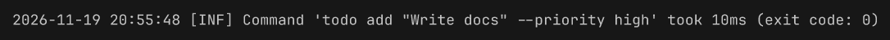

<!--
SPDX-FileCopyrightText: 2026 Adam Shirt <adamshirt@outlook.com>

SPDX-License-Identifier: MIT
-->

# Logging With Interceptors

Real-world CLI apps need visibility to aid diagnosis when something goes wrong. In this step, you'll add an interceptor that logs the command, its parameters, its exit code, and its duration.

Here we're going to configure file logging using Serilog, though any logging framework can be used.

## Add the logging packages

Add Serilog with a file sink:

```bash
dotnet add package Serilog.Extensions.Logging
dotnet add package Serilog.Sinks.File
```

## Configure file logging

Configure Serilog in `Program.cs` and register it with the logging services:

```csharp
using Serilog;

Log.Logger = new LoggerConfiguration()
    .MinimumLevel.Information()
    .WriteTo.File(
        "todo.log",
        outputTemplate: "{Timestamp:yyyy-MM-dd HH:mm:ss} [{Level:u3}] {Message:lj}{NewLine}")
    .CreateLogger();

services.AddLogging(logging => logging.AddSerilog(Log.Logger));
```

The default log level is `Information`. Logs are written to `todo.log`, so standard output and standard error stays clean.

## Add the interceptor

Add the interceptor class to the project:

```csharp
using System.Diagnostics;

using AnyCli.Interceptors;
using Microsoft.Extensions.Logging;

public sealed class LoggingInterceptor(
    ILogger<LoggingInterceptor> logger) : ICommandInterceptorWithExitCode<TodoExitCode>
{
    public async Task<TodoExitCode> InterceptAsync(
        CommandInterceptorContext context,
        Func<CancellationToken, Task<TodoExitCode>> next,
        CancellationToken cancellationToken)
    {
        logger.LogDebug("Received command '{Command}'", context.RawCommand);

        var stopwatch = Stopwatch.StartNew();
        var exitCode = await next.Invoke(cancellationToken);
        stopwatch.Stop();

        logger.LogInformation(
            "Command '{Command}' took {ElapsedMilliseconds}ms (exit code: {ExitCode})",
            context.RawCommand,
            (int)stopwatch.Elapsed.TotalMilliseconds,
            (int)exitCode);

        return exitCode;
    }
}
```

`ICommandInterceptorWithExitCode<TodoExitCode>` keeps the interceptor working with the application's typed exit code while AnyCLI converts it to the process exit code.

## Register the interceptor

Register the interceptor with the container and add it to the application after the commands:

```csharp
services.AddTransient<LoggingInterceptor>();

var app = ConsoleAppBuilder.Create()
    .UseServiceProvider(provider)
    .WithName("todo")
    .ConfigureHelp(help => help
        .UseSpectreHelpRenderer())
    .ConfigureErrorHandling(errors => errors
        .UseSpectreErrorWriter()
        .UseExitCode(TodoExitCode.CommandLineError))
    .ConfigureCommands<TodoExitCode>(commands => commands
        .AddAsyncCommand<ListCommand>("list", "List all tasks")
        .AddAsyncCommand<AddCommand, AddParameters>("add", "Add a task")
        .AddAsyncCommand<DoneCommand, DoneParameters>("done", "Mark a task as done"))
    .AddInterceptor<LoggingInterceptor>()
    .Build();
```

AnyCLI resolves the interceptor from the configured service provider, so its `ILogger<T>` dependency is injected automatically.

Flush the file sink when the application exits:

```csharp
try
{
    return await app.RunAsync(args);
}
finally
{
    await Log.CloseAndFlushAsync();
}
```

## Run the app

Add a task:

```bash
dotnet run -- add "Write docs" --priority high
cat todo.log
```

<p></p>

The interceptor writes a debug message with the raw command before it runs, then an information message after it. At the default `Information` level, the debug message is filtered out. The next step will make the log level configurable through a global option.

## Learn more

- [Write an interceptor](../guides/write-an-interceptor.md)
- [Interceptors reference](../reference/interceptors.md)

## Next

- [Global Options](global-options.md)
