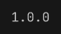

<!--
SPDX-FileCopyrightText: 2026 Adam Shirt <adamshirt@outlook.com>

SPDX-License-Identifier: MIT
-->

# Publish and Distribute

`todo` is now a complete CLI application. In this final step, you'll add a version, package it as a .NET tool, and publish a native executable.

## Set the app version

Add a version to the application builder:

```csharp
var app = ConsoleAppBuilder.Create()
    .UseServiceProvider(provider)
    .WithName("todo")
    .WithVersion("1.0.0")
    // Existing configuration.
    .Build();
```

The version is shown by `--version`:

```bash
dotnet run -- --version
```



## Package as a .NET tool

A .NET tool is a NuGet package that installs a command globally or locally. Add the tool metadata to `TodoCli.csproj`:

```xml
<PropertyGroup>
  <PackAsTool>true</PackAsTool>
  <ToolCommandName>todo</ToolCommandName>
  <Version>1.0.0</Version>
</PropertyGroup>
```

Keep the package version and the version passed to `WithVersion` in sync.

Create the package:

```bash
dotnet pack -c Release
```

Install it from the local build output:

```bash
dotnet tool install --global --add-source ./bin/Release TodoCli
```

Run the installed command:

```bash
todo --version
```

To install a later build, use `dotnet tool update` instead:

```bash
dotnet tool update --global --add-source ./bin/Release TodoCli
```

Once the package is published to NuGet, users can install it without the local source:

```bash
dotnet tool install --global TodoCli
```

## Publish a native executable

AnyCLI supports Native AOT, which produces a self-contained native executable with no .NET runtime requirement. Use the runtime identifier for the target platform:

```bash
dotnet publish -c Release -r osx-arm64 -p:PublishAot=true
```

Common runtime identifiers:

| Platform | Runtime identifier |
| --- | --- |
| Windows x64 | `win-x64` |
| Windows arm64 | `win-arm64` |
| macOS Intel | `osx-x64` |
| macOS Apple silicon | `osx-arm64` |
| Linux x64 | `linux-x64` |
| Linux arm64 | `linux-arm64` |

The executable is written under:

```text
bin/Release/<tfm>/<rid>/publish/TodoCli
```

On Windows the file is `TodoCli.exe`. Native AOT requires the platform's C++ toolchain and linker to be installed.

## Choose an approach

| Approach | Best for |
| --- | --- |
| .NET tool | Easy installation and updates through NuGet; requires the .NET runtime. |
| Native executable | Standalone distribution with fast startup; build separately for each platform. |

## Next

You've completed the Getting Started tutorial. Continue with the how-to guides and reference:

- [Optional and Variadic Arguments](../guides/optional-and-variadic-arguments.md)
- [Handle Cancellation](../guides/handle-cancellation.md)
- [Command-line Syntax](../reference/command-line-syntax.md)
