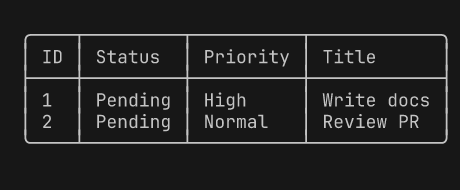

<!--
SPDX-FileCopyrightText: 2026 Adam Shirt <adamshirt@outlook.com>

SPDX-License-Identifier: MIT
-->

# Styled Output With Spectre.Console

Currently `todo` prints all output as plain text. In this step, you'll render the task list as a Spectre.Console table and use Spectre styling for help and command-line errors.

## Add the package

Add the AnyCLI Spectre.Console adaptor:

```bash
dotnet add package AnyCli.SpectreConsole
```

## Add the usings

Add these usings to `Program.cs`:

```csharp
using AnyCli.SpectreConsole;
using Spectre.Console;
```

## Render the task list as a table

Replace `ListCommand` with this version:

```csharp
public sealed class ListCommand : NoParametersAsyncCommand
{
    public override async Task<int> ExecuteAsync(
        CommandContext context,
        CancellationToken cancellationToken)
    {
        var tasks = await new TodoStore("todo.json").LoadAsync(cancellationToken);

        if (tasks.Count == 0)
        {
            context.Console.Output.WriteLine("No tasks yet.");
            return 0;
        }

        var table = new Table()
            .Border(TableBorder.Rounded)
            .AddColumn("ID")
            .AddColumn("Status")
            .AddColumn("Priority")
            .AddColumn("Title");

        foreach (var task in tasks)
        {
            table.AddRow(
                task.Id.ToString(),
                task.IsDone ? "Done" : "Pending",
                task.Priority.ToString(),
                Markup.Escape(task.Title));
        }

        context.AnsiConsole.Output.Write(table);
        return 0;
    }
}
```

`context.AnsiConsole.Output` is a Spectre console for standard output. `Markup.Escape` keeps task titles from being interpreted as Spectre markup.

## Use Spectre help and errors

Configure the default Spectre help provider and the Spectre error writer together:

```csharp
var app = ConsoleAppBuilder.Create()
    .WithName("todo")
    .ConfigureHelp(help => help
        .UseSpectreHelp())
    .ConfigureErrorHandling(errors => errors
        .UseSpectreErrors())
    .ConfigureCommands(commands => commands
        .AddAsyncCommand<ListCommand>("list", "List all tasks")
        .AddAsyncCommand<AddCommand, AddParameters>("add", "Add a task"))
    .Build();
```

AnyCLI's own command-line errors, such as an unknown option, are now written through the Spectre error writer.

## Run the app

Add a couple of tasks if you have not already done so:

```bash
dotnet run -- add "Write docs" --priority high
dotnet run -- add "Review PR" --priority normal
```

List the tasks:

```bash
dotnet run -- list
```



Command-line errors are styled too:

```bash
dotnet run -- add "Write docs" --unknown
```


## Next

- [Typed Exit Codes](typed-exit-codes.md)
