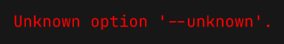

<!--
SPDX-FileCopyrightText: 2026 Adam Shirt <adamshirt@outlook.com>

SPDX-License-Identifier: MIT
-->

# Styled Output With Spectre.Console

Currently `todo` prints all output as plain text. In this step, you'll render the task list as a Spectre.Console table and use Spectre styling for help and command-line errors.

## Add the package

Add the AnyCLI Spectre.Console adaptor:

```bash
dotnet add package AnyCli.SpectreConsole
```

## Add the usings

Add these usings to `Program.cs`:

```csharp
using AnyCli.SpectreConsole;
using Spectre.Console;
```

## Render the task list as a table

Replace `ListCommand` with this version:

```csharp
public sealed class ListCommand : NoParametersAsyncCommand
{
    public override async Task<int> ExecuteAsync(
        CommandContext context,
        CancellationToken cancellationToken)
    {
        var tasks = await new TodoStore(TodoStore.DataPath).LoadAsync(cancellationToken);

        if (tasks.Count == 0)
        {
            context.AnsiConsole.Output.MarkupLine("[yellow]No tasks yet.[/]");
            context.AnsiConsole.Output.MarkupLine(
                "[grey]Add one with: todo add \"Write docs\"[/]");
            return 0;
        }

        var table = new Table()
            .Border(TableBorder.Rounded)
            .AddColumn("ID")
            .AddColumn("Status")
            .AddColumn("Priority")
            .AddColumn("Title");

        foreach (var task in tasks)
        {
            table.AddRow(
                $"[grey]{task.Id}[/]",
                task.IsDone ? "[green]Done[/]" : "[yellow]Pending[/]",
                task.Priority switch
                {
                    TodoPriority.High => "[red]High[/]",
                    TodoPriority.Low => "[grey]Low[/]",
                    _ => "Normal",
                },
                Markup.Escape(task.Title));
        }

        context.AnsiConsole.Output.Write(table);

        var done = tasks.Count(task => task.IsDone);
        var pending = tasks.Count - done;

        context.AnsiConsole.Output.MarkupLineInterpolated(
            $"[grey]{tasks.Count} tasks · {done} done · {pending} pending[/]");
        return 0;
    }
}
```

`context.AnsiConsole.Output` is a Spectre console for standard output. IDs are grey, statuses and priorities use their own colours, and the summary line sits below the table. `Markup.Escape` keeps task titles from being interpreted as Spectre markup.

## Update the add output

`AddCommand` still writes plain text. Update its success message so it follows the same pattern:

```csharp
public sealed class AddCommand : IAsyncCommand<AddParameters>
{
    public async Task<int> ExecuteAsync(
        CommandContext context,
        AddParameters parameters,
        CancellationToken cancellationToken)
    {
        var store = new TodoStore(TodoStore.DataPath);
        var tasks = (await store.LoadAsync(cancellationToken)).ToList();
        var id = tasks.Count == 0 ? 1 : tasks.Max(task => task.Id) + 1;

        tasks.Add(new TodoItem(id, parameters.Title, parameters.Priority));
        await store.SaveAsync(tasks, cancellationToken);

        context.AnsiConsole.Output.MarkupLineInterpolated(
            $"[green]Added task [bold]{id}[/]: {Markup.Escape(parameters.Title)} ({parameters.Priority.ToString().ToLowerInvariant()})[/]");
        return 0;
    }
}
```

Successful changes are fully green, task IDs are bold, and only secondary hints use grey.

## Use Spectre help and errors

Configure the default Spectre help provider and the Spectre error writer together:

```csharp
var app = ConsoleAppBuilder.Create()
    .WithName("todo")
    .ConfigureHelp(help => help
        .UseSpectreHelp())
    .ConfigureErrorHandling(errors => errors
        .UseSpectreErrors())
    .ConfigureCommands(commands => commands
        .AddAsyncCommand<ListCommand>("list", "List all tasks")
        .AddAsyncCommand<AddCommand, AddParameters>("add", "Add a task"))
    .Build();
```

AnyCLI's own command-line errors, such as an unknown option, are now written through the Spectre error writer.

## Run the app

Add a couple of tasks if you have not already done so:

```bash
dotnet run -- add "Write docs" --priority high
dotnet run -- add "Review PR" --priority normal
```

List the tasks:

```bash
dotnet run -- list
```


Command-line errors are styled too:

```bash
dotnet run -- add "Write docs" --unknown
```



## Learn more

- [Render rich output](../guides/spectre/render-rich-output.md)
- [Use Spectre.Console help](../guides/spectre/use-spectre-help.md)
- [Use Spectre.Console errors](../guides/spectre/use-spectre-errors.md)
- [Spectre.Console adapter reference](../reference/spectre-console-adapter.md)

## Next

- [Typed Exit Codes](typed-exit-codes.md)
