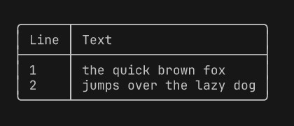

<!--
SPDX-FileCopyrightText: 2026 Adam Shirt <adamshirt@outlook.com>

SPDX-License-Identifier: MIT
-->

# Styled Output With Spectre.Console

`fsinspect` currently prints the preview as plain text. In this step, you'll render it as a Spectre.Console table and use Spectre styling for command-line errors.

## Add the package

Add the AnyCLI Spectre.Console adaptor:

```bash
dotnet add package AnyCli.SpectreConsole
```

## Add the usings

Add these usings to `Program.cs`:

```csharp
using AnyCli.SpectreConsole;
using Spectre.Console;
```

## Render the preview as a table

Replace `PreviewCommand` with this version:

```csharp
public sealed class PreviewCommand : IAsyncCommand<PreviewParameters>
{
    public async Task<int> ExecuteAsync(
        CommandContext context,
        PreviewParameters parameters,
        CancellationToken cancellationToken)
    {
        if (!File.Exists(parameters.Path))
        {
            context.Console.Error.WriteLine($"File not found: {parameters.Path}");
            return 1;
        }

        var table = new Table()
            .Border(TableBorder.Rounded)
            .AddColumn("Line")
            .AddColumn("Text");

        var number = 0;
        await foreach (var line in File.ReadLinesAsync(parameters.Path, cancellationToken))
        {
            if (number == parameters.Lines) break;
            number++;
            table.AddRow(number.ToString(), Markup.Escape(line));
        }

        context.AnsiConsole.Output.Write(table);
        return 0;
    }
}
```

`context.AnsiConsole.Output` is a Spectre console for standard output. The command builds a table with one row per preview line and writes the finished table. `Markup.Escape` keeps file content from being interpreted as Spectre markup.

## Style command-line errors

AnyCLI's own command-line errors can use Spectre styling too. Update the app registration:

```csharp
var app = ConsoleAppBuilder.Create()
    .WithName("fsinspect")
    .ConfigureErrorHandling(errors => errors
        .UseWriter<SpectreCommandErrorWriter>())
    .ConfigureCommands(commands => commands
        .AddCommand<InspectCommand>("info", "Show information about the current directory")
        .AddAsyncCommand<PreviewCommand, PreviewParameters>("preview", "Preview the first lines of a file"))
    .Build();
```

The command still handles its own file-not-found error. AnyCLI errors, such as an unknown option, are now written through the Spectre error writer.

## Run the app

Using the `sample.txt` from the previous step, render the first two lines:

```bash
dotnet run -- preview sample.txt --lines 2
```



Command-line errors are also styled:

```bash
dotnet run -- preview sample.txt --bad
```


## Next

- [Typed Exit Codes](typed-exit-codes.md)
