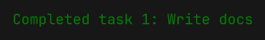
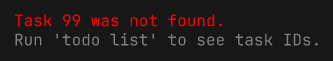

<!--
SPDX-FileCopyrightText: 2026 Adam Shirt <adamshirt@outlook.com>

SPDX-License-Identifier: MIT
-->

# Typed Exit Codes

Scripts and automation rely on predictable process exit codes. At the moment `todo` uses integer exit codes, which is straightforward but becomes difficult to maintain as more commands and statuses are added. In this step, you'll replace them with a shared enum and add a `done` command that marks a task as complete.

## Add the exit code type

Add this enum to the project:

```csharp
public enum TodoExitCode
{
    Success = 0,
    TaskNotFound = 1,
    CommandLineError = 2,
}
```

The enum values are the process exit codes returned by the application.

## Update ListCommand

Change `ListCommand` to use `NoParametersCommand<TodoExitCode>` and return the enum:

```csharp
public sealed class ListCommand : NoParametersAsyncCommand<TodoExitCode>
{
    public override async Task<TodoExitCode> ExecuteAsync(
        CommandContext context,
        CancellationToken cancellationToken)
    {
        var tasks = await new TodoStore(TodoStore.DataPath).LoadAsync(cancellationToken);

        if (tasks.Count == 0)
        {
            context.AnsiConsole.Output.MarkupLine("[yellow]No tasks yet.[/]");
            context.AnsiConsole.Output.MarkupLine(
                "[grey]Add one with: todo add \"Write docs\"[/]");
            return TodoExitCode.Success;
        }

        var table = new Table()
            .Border(TableBorder.Rounded)
            .AddColumn("ID")
            .AddColumn("Status")
            .AddColumn("Priority")
            .AddColumn("Title");

        foreach (var task in tasks)
        {
            table.AddRow(
                $"[grey]{task.Id}[/]",
                task.IsDone ? "[green]Done[/]" : "[yellow]Pending[/]",
                task.Priority switch
                {
                    TodoPriority.High => "[red]High[/]",
                    TodoPriority.Low => "[grey]Low[/]",
                    _ => "Normal",
                },
                Markup.Escape(task.Title));
        }

        context.AnsiConsole.Output.Write(table);

        var done = tasks.Count(task => task.IsDone);
        var pending = tasks.Count - done;

        context.AnsiConsole.Output.MarkupLineInterpolated(
            $"[grey]{tasks.Count} tasks · {done} done · {pending} pending[/]");
        return TodoExitCode.Success;
    }
}
```

## Update AddCommand

Change `AddCommand` to implement `IAsyncCommand<AddParameters, TodoExitCode>` and return `TodoExitCode.Success`:

```csharp
public sealed class AddCommand : IAsyncCommand<AddParameters, TodoExitCode>
{
    public async Task<TodoExitCode> ExecuteAsync(
        CommandContext context,
        AddParameters parameters,
        CancellationToken cancellationToken)
    {
        var store = new TodoStore(TodoStore.DataPath);
        var tasks = (await store.LoadAsync(cancellationToken)).ToList();
        var id = tasks.Count == 0 ? 1 : tasks.Max(task => task.Id) + 1;

        tasks.Add(new TodoItem(id, parameters.Title, parameters.Priority));
        await store.SaveAsync(tasks, cancellationToken);

        context.AnsiConsole.Output.MarkupLineInterpolated(
            $"[green]Added task [bold]{id}[/]: {Markup.Escape(parameters.Title)} ({parameters.Priority.ToString().ToLowerInvariant()})[/]");
        return TodoExitCode.Success;
    }
}
```

## Add the done command

Add the parameter type and command for marking a task as complete:

```csharp
public sealed partial record DoneParameters
{
    [Argument(0)]
    public int Id { get; init; }
}

public sealed class DoneCommand : IAsyncCommand<DoneParameters, TodoExitCode>
{
    public async Task<TodoExitCode> ExecuteAsync(
        CommandContext context,
        DoneParameters parameters,
        CancellationToken cancellationToken)
    {
        var store = new TodoStore(TodoStore.DataPath);
        var tasks = (await store.LoadAsync(cancellationToken)).ToList();
        var index = tasks.FindIndex(task => task.Id == parameters.Id);

        if (index < 0)
        {
            context.AnsiConsole.Error.MarkupLineInterpolated(
                $"[red]Task {parameters.Id} was not found.[/]");
            context.AnsiConsole.Error.MarkupLine(
                "[grey]Run 'todo list' to see task IDs.[/]");
            return TodoExitCode.TaskNotFound;
        }

        tasks[index] = tasks[index] with { IsDone = true };
        await store.SaveAsync(tasks, cancellationToken);

        context.AnsiConsole.Output.MarkupLineInterpolated(
            $"[green]Completed task [bold]{parameters.Id}[/]: {Markup.Escape(tasks[index].Title)}[/]");
        return TodoExitCode.Success;
    }
}
```

## Register the commands

Update the app registration to use `ConfigureCommands<TodoExitCode>` and set the command-line error exit code to `CommandLineError`:

```csharp
var app = ConsoleAppBuilder.Create()
    .WithName("todo")
    .ConfigureHelp(help => help
        .UseSpectreHelp())
    .ConfigureErrorHandling(errors => errors
        .UseSpectreErrors()
        .UseExitCode(TodoExitCode.CommandLineError))
    .ConfigureCommands<TodoExitCode>(commands => commands
        .AddAsyncCommand<ListCommand>("list", "List all tasks")
        .AddAsyncCommand<AddCommand, AddParameters>("add", "Add a task")
        .AddAsyncCommand<DoneCommand, DoneParameters>("done", "Mark a task as done"))
    .Build();
```

`ConfigureCommands<TodoExitCode>` requires every registered command to return that enum. `UseExitCode` maps command-line errors to `CommandLineError`, keeping them distinct from application failures.

## Run the app

Successful commands return `TodoExitCode.Success`, which is exit code `0`:

```bash
dotnet run -- list
dotnet run -- add "Write docs" --priority high
dotnet run -- done 1
```



Marking a task that does not exist returns `TodoExitCode.TaskNotFound`, which is exit code `1`:

```bash
dotnet run -- done 99
```



You now have a persisted, styled todo CLI with typed exit codes, help, localization, and structured error handling.

## Next

- [Dependency Injection](dependency-injection.md)
