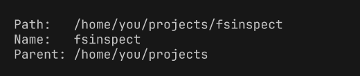

<!--
SPDX-FileCopyrightText: 2026 Adam Shirt <adamshirt@outlook.com>

SPDX-License-Identifier: MIT
-->

# Your First CLI App

`fsinspect` is a small utility for inspecting the file system. In this first step, you will build a minimal version with one command that reports information about the current directory.

## Create the project

Create a new console application and add AnyCLI:

```bash
dotnet new console -n FsInspect
cd FsInspect
dotnet add package AnyCli
```

## Add the command

Replace `Program.cs` with the following:

```csharp
using AnyCli.Commands.Execution;
using AnyCli.Commands.Registration;

var app = ConsoleAppBuilder.Create()
    .WithName("fsinspect")
    .ConfigureCommands(commands => commands
        .AddCommand<InspectCommand>("info", "Show information about the current directory"))
    .Build();

return await app.RunAsync(args);

public sealed class InspectCommand : NoParametersCommand
{
    public override int Execute(CommandContext context)
    {
        var directory = new DirectoryInfo(Environment.CurrentDirectory);

        context.Console.Output.WriteLine($"Path:   {directory.FullName}");
        context.Console.Output.WriteLine($"Name:   {directory.Name}");
        context.Console.Output.WriteLine($"Parent: {directory.Parent?.FullName ?? "(none)"}");

        return 0;
    }
}
```

`NoParametersCommand` is the simplest command shape. It receives a `CommandContext`, performs its work, and returns the process exit code. Returning `0` reports success.

`ConsoleAppBuilder` creates the application, `AddCommand` registers `InspectCommand` under the name `info`, and `RunAsync` runs the application with the process arguments.

## What this gives you

Even with one command and no parameters, the application provides:

- Help for the application and `info` through `-h` or `--help`, with localised headings and built-in descriptions.
- A default error message provider for invalid input, with localised messages in seven languages.
- Structured command-line errors on standard error, returning exit code `2` by default.
- Command exit codes propagated to the process, plus plain output and error writers through the command context.

## Run the app

Run the `info` command:

```bash
dotnet run -- info
```

The output looks like:



The `--` separates arguments for `dotnet run` from arguments for the application. Everything after it is passed to `fsinspect`; here, `info` selects the command.

## Next

- [Arguments and Options](arguments-and-options.md)
