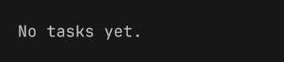

<!--
SPDX-FileCopyrightText: 2026 Adam Shirt <adamshirt@outlook.com>

SPDX-License-Identifier: MIT
-->

# Your First CLI App

Following this tutorial, you'll build `todo`, a feature-complete task manager for the terminal. By the end, you'll have a complete CLI application with several commands, localised in 7 languages, with rich rendered output, help and error handling, typed exit codes, and more.

In this first step, you'll create a minimal version with a `list` command and a small JSON-backed task store.

## Create the project

Create a new console application and add AnyCLI:

```bash
dotnet new console -n TodoCli
cd TodoCli
dotnet add package AnyCli
```

## Add the task store

Replace `Program.cs` with the following:

```csharp
using System.Text.Json;

using AnyCli.Commands.Execution;
using AnyCli.Commands.Registration;

var app = ConsoleAppBuilder.Create()
    .WithName("todo")
    .ConfigureCommands(commands => commands
        .AddAsyncCommand<ListCommand>("list", "List all tasks"))
    .Build();

return await app.RunAsync(args);

/// <summary>A persisted task.</summary>
public sealed record TodoItem(int Id, string Title, bool IsDone = false);

/// <summary>Reads tasks from a JSON file.</summary>
public sealed class TodoStore(string path)
{
    public async Task<IReadOnlyList<TodoItem>> LoadAsync(
        CancellationToken cancellationToken)
    {
        if (!File.Exists(path)) return [];

        var json = await File.ReadAllTextAsync(path, cancellationToken);
        return JsonSerializer.Deserialize<List<TodoItem>>(json) ?? [];
    }
}

public sealed class ListCommand : NoParametersAsyncCommand
{
    public override async Task<int> ExecuteAsync(
        CommandContext context,
        CancellationToken cancellationToken)
    {
        var tasks = await new TodoStore("todo.json").LoadAsync(cancellationToken);

        if (tasks.Count == 0)
        {
            context.Console.Output.WriteLine("No tasks yet.");
            return 0;
        }

        foreach (var task in tasks)
        {
            var status = task.IsDone ? "done" : "pending";
            context.Console.Output.WriteLine($"{task.Id}: [{status}] {task.Title}");
        }

        return 0;
    }
}
```

`ListCommand` is the simplest asynchronous command shape. It receives a `CommandContext` and a cancellation token, performs its work, and returns the process exit code.

`ConsoleAppBuilder` creates the application, `AddAsyncCommand` registers `ListCommand` under the name `list`, and `RunAsync` runs the application with the process arguments.

## What this gives you

Even with one command and no parameters, the application provides:

- Help for the application and `list` through `-h` or `--help`, with localized headings and built-in descriptions.
- A default error message provider for invalid input, with localized messages in seven languages.
- Structured command-line errors on standard error, returning exit code `2` by default.
- Command exit codes propagated to the process.

## Run the app

List the tasks:

```bash
dotnet run -- list
```

The output looks like:



The `--` separates arguments for `dotnet run` from arguments for the application. Everything after it is passed to `todo`; here, `list` selects the command.

## Next

- [Arguments and Options](arguments-and-options.md)
