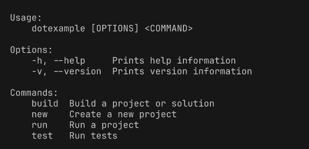
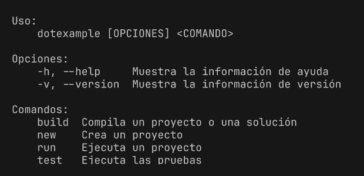

<!--
SPDX-FileCopyrightText: 2026 Adam Shirt <adamshirt@outlook.com>

SPDX-License-Identifier: MIT
-->

# AnyCLI

[](https://github.com/drmathias/anycli/actions/workflows/test.yml)
[](https://github.com/drmathias/anycli/blob/main/LICENSES/MIT.txt)
[](https://dotnet.microsoft.com/)
[](https://dotnet.microsoft.com/)
[](https://learn.microsoft.com/dotnet/core/deploying/native-aot/)

AnyCLI is a typed, performant and Native-AOT ready command-line framework for .NET 10 and 11. At its core it provides command, argument and option parsing, built-in help and structured errors, first-class localization support with out-of-the-box translations for seven languages, provider-agnostic DI support, and so much more.

## Packages

| Package | Version | What it provides |
| --- | --- | --- |
| [`AnyCli`](https://www.nuget.org/packages/AnyCli) | [](https://www.nuget.org/packages/AnyCli) | Core framework for building CLI applications. |
| [`AnyCli.SpectreConsole`](https://www.nuget.org/packages/AnyCli.SpectreConsole) | [](https://www.nuget.org/packages/AnyCli.SpectreConsole) | Styled output, tables, markup, and rich rendering capabilities. |

Install the core package:

```bash
dotnet add package AnyCli
```

Add the Spectre.Console adaptor when you want rich rendering:

```bash
dotnet add package AnyCli.SpectreConsole
```

## Why use AnyCLI?

AnyCLI is built around a deliberate balance between performance and utility. Common operations stay small and predictable, while help, errors, parameter binding, localization, and output rendering are available out the box.

It was created because the other available packages were either too verbose, too opinionated, or simply lacking in features.

With AnyCLI, every major behavior is extensible. The help provider, error handler, message provider, console writer, parameter parsers, interceptors, and service resolution can be replaced to fit the application.

AnyCLI is a good fit for:

- Command-line applications that need predictable parsing and clear failure modes.
- Tools where startup, allocation, and command dispatch cost matter.
- Applications that need help and error messages localized from day one.
- Projects that want Native AOT support without giving up a conventional .NET programming model.
- Tools that need rich terminal output while keeping a plain-text fallback available.

## Localization, out the box

<table>
  <thead>
    <tr>
      <th>English</th>
      <th>Spanish</th>
    </tr>
  </thead>
  <tbody>
    <tr>
      <td></td>
      <td></td>
    </tr>
  </tbody>
</table>

## Features

### Commands and parameters

Commands are ordinary .NET classes, and their parameters are plain objects. Commands can be nested into groups, and parameters support required, optional, variadic, repeated, collection, and defaulted values. Positional arguments, named options, short aliases, grouped flags, enums, and custom parsers are all supported.

### Global options

Global options are declared once and inherited by every command. They can appear before or after the command name.

### Exit codes and cancellation

Commands can return strongly typed exit codes, and asynchronous commands can observe cancellation.

### Dependency injection and interceptors

Commands and framework services support dependency injection. Interceptors can run shared logic before and after command execution for logging, timing, validation, or setup.

### Help and structured errors

Help output is available by default and can be replaced. Failures are represented as structured errors, with configurable handlers, messages, output writers, and exit codes.

### Localisation

Help headings, built-in option descriptions, and error messages are localised for seven languages. Application descriptions can be localised in the same way, and UI and formatting cultures can be configured independently.

### Performance and Native AOT

AnyCLI supports Native AOT and trimming. The common parsing and dispatch path is designed to stay small and allocation-light.

### Spectre.Console adaptor

The optional Spectre.Console adaptor adds rich output, tables, panels, markup, and styled error rendering. Plain console output remains available when rich rendering is not needed.

## Next

- [Getting Started](getting-started/your-first-cli-app.md)
